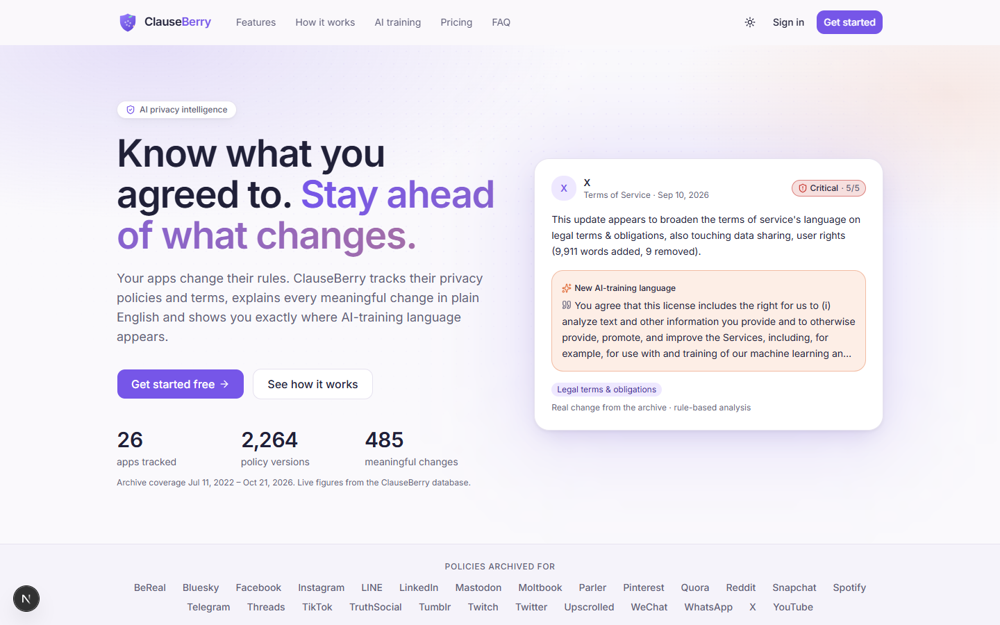
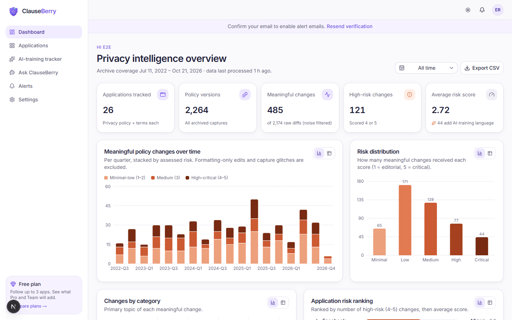
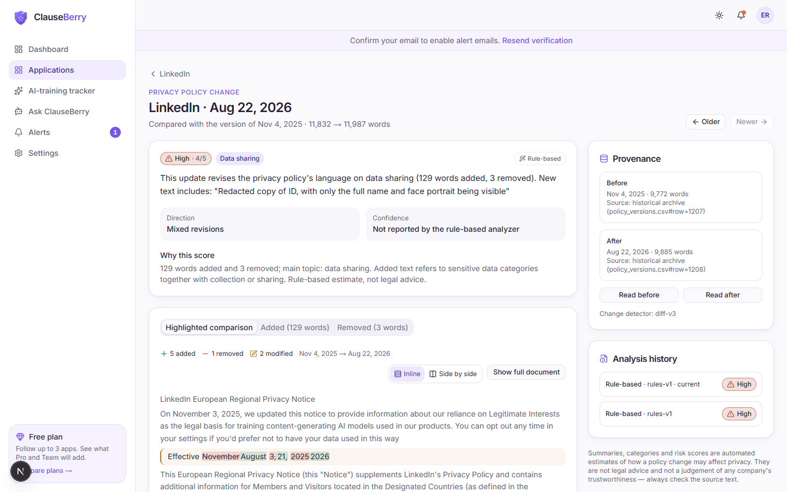
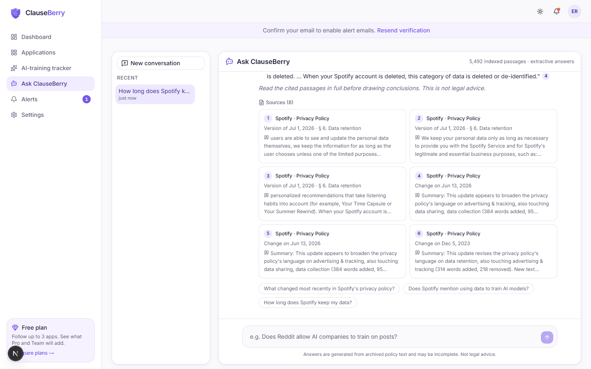
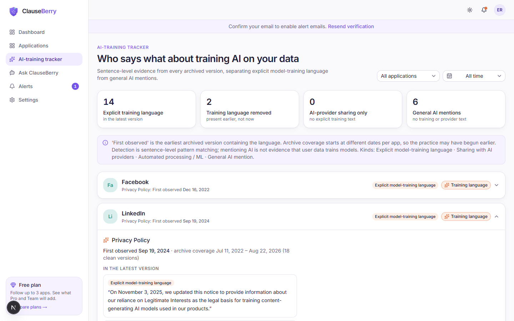
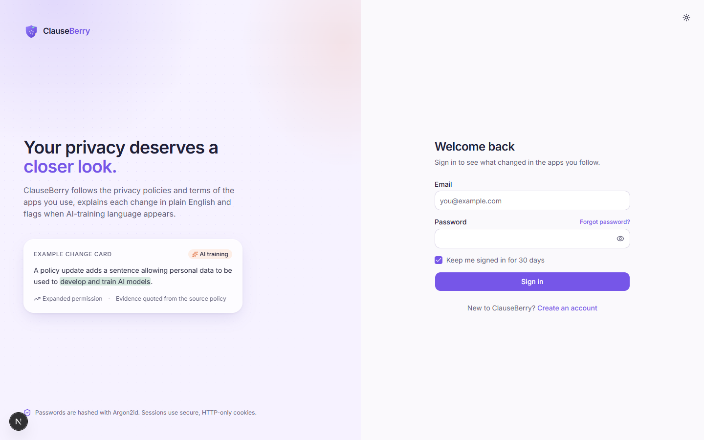
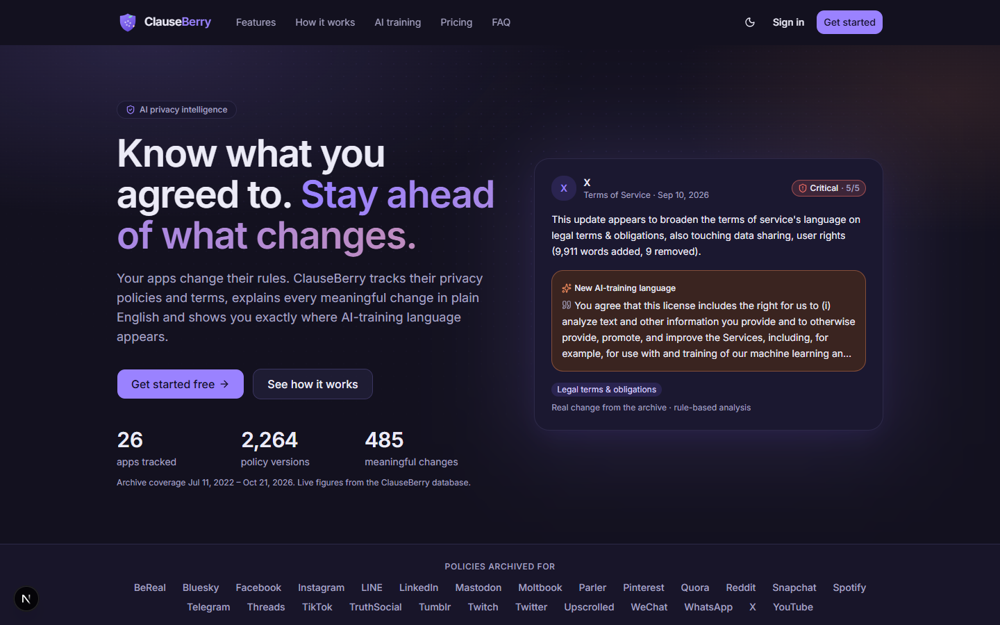
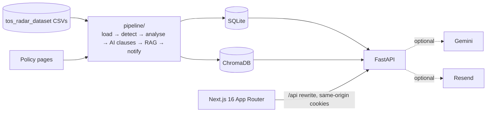

# ClauseBerry — AI Privacy Intelligence Platform

**Know what you agreed to. Stay ahead of what changes.**

ClauseBerry tracks how apps' privacy policies and terms of service change, explains each meaningful change
in plain English with a documented 1–5 risk score, tracks AI-training clauses sentence by sentence, and
answers questions with citations to the exact policy text.

> Summaries and scores are automated estimates, not legal advice and not judgements of any company's trustworthiness.



## The problem

Policies are long, change often, and rarely say what changed. Archives exist, but raw diffs are mostly noise
(rotating image URLs, markup, regional variants, broken captures). In this dataset only **485 of 2,174**
consecutive-version diffs (22 %) contain a meaningful wording change.

## Features

| | |
|---|---|
| **Dashboard** | KPIs, changes over time by risk, risk distribution, categories, app risk ranking, AI-language timeline, policy length, app × category heatmap — all from the API, with date filters and table views. |
| **Applications** | Searchable, filterable directory; per-app page with latest change, documents, change list (search/date/risk/noise filters), insights charts, AI-training history, version history and any-two-version comparison. |
| **Change detail** | Summary, category, risk with reasoning, direction, evidence quotes, word-level highlighted diff (inline or side-by-side), added/removed text, provenance and analysis history. |
| **AI-training tracker** | Explicit training language vs. AI-provider sharing vs. general AI mentions, first-observed dates with coverage caveats, clause timelines with exact quotes. |
| **Ask ClauseBerry** | Streaming RAG chat over ChromaDB with source cards, follow-ups, saved history and an explicit "insufficient evidence" path. |
| **Alerts** | Follow apps (Free: 3), alerts with read state and filters, notification preferences, email digests via Resend. |
| **Accounts** | Sign-up/sign-in with Argon2id + server-side sessions + CSRF, email verification, password reset/change, theme, account deletion. |
| **Pricing** | Free / Pro / Team concept; paid tiers are a waitlist — no payment is ever taken. |

## Screenshots

| Dashboard | Change comparison |
|---|---|
|  |  |
| **Ask ClauseBerry** | **AI-training tracker** |
|  |  |
| **Sign in** | **Dark mode** |
|  |  |

More in [`docs/screenshots/`](docs/screenshots) (captured by the Playwright suite with `SCREENSHOTS=1`).

## Architecture



Details: [docs/architecture.md](docs/architecture.md) (data model, change verdicts, risk rubric, KPI definitions, RAG, security).

## Technology

* **Frontend:** Next.js 16 (App Router, Cache Components), TypeScript strict, Tailwind CSS 4, shadcn/ui (Radix), Lucide, Recharts, SWR, React Hook Form + Zod, next-themes, Sonner, Playwright.
* **Backend:** Python 3.13, FastAPI, Pydantic v2, SQLite (versioned SQL migrations, analytics views), argon2-cffi, httpx, pytest.
* **AI:** ChromaDB, sentence-transformers (`all-MiniLM-L6-v2`, local CPU), Google Gemini (optional, structured JSON output).
* **Data:** pandas, difflib, BeautifulSoup. **Automation:** GitHub Actions.

## Dataset and licence

Source: `tos_radar_dataset/` — built from the **Platform Governance Archive (PGA v2)**, collected with
**Open Terms Archive** ([pga-versions](https://github.com/OpenTermsArchive/pga-versions)), licensed under the
**Open Database License (ODbL)**.

> Data from Open Terms Archive contributors / Platform Governance Archive.

The licence and attribution text come from the dataset's own `README.md`. Under ODbL's share-alike terms,
databases derived from it (e.g. `data/clauseberry.db`) must be offered under the ODbL if publicly used.
The original files are never modified. Full profile: [docs/dataset_report.md](docs/dataset_report.md).

**Storage in Git.** `policy_versions.csv` (162 MiB) is the only file in Git LFS; the other CSVs are normal Git
files. `.gitattributes` marks the whole dataset folder `-text`, so line endings (two CSVs use CRLF) are stored
byte-for-byte; `scripts/verify_dataset.py` checks every file against `scripts/dataset.sha256`. On GitHub Free,
LFS includes 10 GiB storage and 10 GiB download bandwidth per month (checked 2026-10-24): one clone with
`git lfs pull` uses ~162 MiB, i.e. roughly 60 full clones a month. The daily workflow caches LFS objects, so
scheduled runs normally use no LFS bandwidth. Re-uploading a changed copy of the file would add another 162 MiB
of storage, so the dataset should stay unchanged.

### Actual statistics

| | |
|---|---|
| Services | 26 (BeReal … YouTube; Twitter and X kept separate, as in the archive) |
| Documents | 52 (privacy policy + terms for each) |
| Policy versions | 2,270 rows → 2,264 stored (6 exact duplicates); 38 flagged as capture errors |
| Coverage | 2022-07-11 → 2026-10-21 |
| Version pairs diffed | 2,174 → **485 meaningful** (1,332 formatting-only, 180 reverts/variants, 108 trivial, 47 partial captures, 16 date-only, 6 restorations) |
| Risk (rule-based) | 1: 65 · 2: 171 · 3: 128 · 4: 77 · 5: 44 |
| Changes adding explicit AI-training language | 44 |
| Apps with explicit training language in latest version | 14 (2 more had it earlier) |
| RAG index | 5,492 chunks (latest versions + meaningful changes) |

## Repository layout

```
D:\Projects\TOS
├─ tos_radar_dataset\      original dataset (read-only; policy_versions.csv in Git LFS)
├─ pipeline\               inspect_dataset, load_db, clean_changes, fetch_policies, analyze_llm,
│                          ai_clauses, build_rag, notify, run_pipeline (+ catalog, taxonomy, textnorm)
├─ backend\app\            main, core (config, errors, rate limit), db, routes, schemas, security, services
├─ backend\tests\          pytest suite
├─ frontend\               Next.js app (app/, components/, hooks/, lib/, e2e/)
├─ database\migrations\    versioned SQL schema + views
├─ evaluation\             labels/ (blind sheet), predictions/ (git-ignored), scripts/, reports/
├─ data\                   generated DB + Chroma index (git-ignored)
├─ docs\                   architecture, dataset report, evaluation, deployment, screenshots
├─ scripts\                export_public_state, verify_dataset (+ dataset.sha256), check_gemini
├─ deploy\                 fly.toml.example
├─ Dockerfile               backend image (non-root, state on /data)
└─ .github\workflows\      ci.yml, daily-pipeline.yml, server-pipeline.yml
```

## Local setup (Windows PowerShell)

Requirements: Python 3.13, Node.js 20+ (tested on 24), Git with Git LFS.

```powershell
cd D:\Projects\TOS

# Dataset: policy_versions.csv (170 MB) is stored in Git LFS
git lfs install
git lfs pull
python scripts\verify_dataset.py      # SHA-256 check against scripts\dataset.sha256

# Backend + pipeline
python -m venv .venv
.\.venv\Scripts\Activate.ps1
pip install -r backend\requirements.txt
Copy-Item .env.example .env          # optional keys: GEMINI_API_KEY, RESEND_API_KEY

# Frontend
cd frontend
npm install
Copy-Item .env.example .env.local
cd ..
```

### Build the database and index

```powershell
python -m pipeline.inspect_dataset   # writes docs\dataset_report.md
python -m pipeline.load_db           # schema + dataset import (idempotent, ~1 min)
python -m pipeline.clean_changes     # change detection (~1 min)
python -m pipeline.analyze_llm       # rule-based analysis (no Gemini calls without --limit N / --all)
python -m pipeline.ai_clauses        # AI-clause evidence per version
python -m pipeline.build_rag         # embeddings + Chroma (first run downloads the model; CPU time varies)
# or everything, incrementally:
python -m pipeline.run_pipeline --skip-fetch --no-email
```

Other steps: `python -m pipeline.fetch_policies [--only reddit,spotify] [--dry-run]`,
`python -m pipeline.notify [--no-email]`.

### Gemini (optional, paid)

```powershell
python scripts\check_gemini.py --list-only   # models your key can use; no generation
python scripts\check_gemini.py               # one small structured-output test call
python -m pipeline.analyze_llm --limit 5      # at most 5 new Gemini calls; results cached by content hash
```

Gemini is never called without an explicit budget (`--limit N`, `--all`, or `--llm-limit N` for
`run_pipeline`), so setting `GEMINI_API_KEY` alone cannot start a large paid batch. Failed calls leave the
existing rule-based analysis in place and mark the run `partial`; cached results are reused for free.

### Run

```powershell
# terminal 1 (project root, venv active)
uvicorn backend.app.main:app --reload --port 8000      # OpenAPI docs: http://localhost:8000/docs
# terminal 2
cd frontend; npm run dev                                 # http://localhost:3000
```

### Environment variables

| Variable | Where | Purpose |
|---|---|---|
| `APP_ENV` | backend | `development` (dev email links shown), `production` (secure cookies), `test` |
| `FRONTEND_URL`, `CORS_ORIGINS` | backend | links in emails; allowed origins |
| `CLAUSEBERRY_DB_PATH`, `CLAUSEBERRY_CHROMA_PATH` | backend/pipeline | storage locations (point at a persistent volume in production) |
| `GEMINI_API_KEY`, `GEMINI_MODEL` | backend/pipeline | optional LLM analysis + generative answers |
| `RESEND_API_KEY`, `EMAIL_FROM` | backend/pipeline | optional email delivery |
| `EMBEDDING_MODEL`, `RAG_CHUNK_WORDS`, `RAG_CHUNK_OVERLAP` | pipeline | retrieval configuration |
| `FETCH_USER_AGENT` | pipeline | identifies the fetcher to site operators |
| `POLICY_MONITORING_ENABLED`, `POLICY_CHECK_INTERVAL_HOURS` | backend | local scheduler (enabled by default; 24 hours by default) |
| `TRUSTED_PROXY_HOPS` | backend | proxies whose `X-Forwarded-For` entries are trusted (default 0 = ignore header) |
| `BACKEND_URL` | frontend | where Next.js proxies `/api/*` (read at **build** time) |

Without `GEMINI_API_KEY`, analysis uses the rule-based analyzer (labelled "Rule-based" everywhere) and chat
answers are extractive quotes (labelled "Extractive mode"). Without `RESEND_API_KEY`, emails are written to
the `email_outbox` table with status `logged` and never reported as sent; in development the verification/reset
link is shown in the UI and printed in the API log (outside development, email bodies are never logged).

## Tests

```powershell
python scripts\verify_dataset.py                  # dataset byte-identical to the original
python -m pytest                                  # backend tests (isolated temp DB)
python -m evaluation.scripts.eval_rag             # retrieval + citation checks against the real index
cd frontend
npm run typecheck; npm run lint; npm run build
$env:PW_CHANNEL="msedge"; npx playwright test     # e2e against running servers; uses installed Edge
```

Results on 2026-10-24:

| Check | Result |
|---|---|
| Dataset integrity (`verify_dataset.py`) | all 4 files match the original SHA-256 |
| Backend tests (pipeline, auth/authorization, API, isolation, RAG, LLM handling, email, evaluation) | **63 passed** |
| Frontend type check / lint / production build | pass / pass / pass (22 routes) |
| Browser tests, development setup | **13/13 passed** |
| Browser tests, production build → Docker API (Secure cookies, sanitised seed) | **13/13 passed** |
| Docker smoke test (health, migrations, non-root, restart persistence, spoofed-IP limit, scheduled run) | pass — see `docs/deployment.md` |
| RAG citation check | evidence-hit@5 0.79 (11/14); 33/33 quotes verbatim; 0 invalid citations |

## Evaluation

Measured (automatic, see [docs/evaluation.md](docs/evaluation.md)): evidence-hit@5 for explicit AI-training
sentences **0.79** (11/14 apps); quoted passages verbatim in cited chunks **33/33**; 0 fabricated citation markers.

Human evaluation of change analysis (category macro-F1, AI-training P/R/F1, risk agreement and weighted κ):
**pending** — a blind 40-change labelling sheet is ready in `evaluation/labels/`; no labels have been collected.
After running the LLM analyzer, score it on the same labelled sample with
`python -m evaluation.scripts.sample_for_labeling --snapshot-only --analyzer llm` and
`python -m evaluation.scripts.compute_metrics --predictions predictions_llm.csv`.

## GitHub Actions

* `ci.yml` — backend tests; frontend typegen, type check, lint, build.
* `daily-pipeline.yml` — scheduled public-data pipeline (fetch → detect → analyse → index) with email disabled.
  Pulls the dataset from Git LFS through an Actions cache, verifies checksums, uploads a **sanitised** state
  artifact. Optional: secret `GEMINI_API_KEY`, variables `GEMINI_MODEL`, `LLM_DAILY_LIMIT` (default 0), `FETCH_USER_AGENT`.
* `server-pipeline.yml` — runs the pipeline inside the deployed API machine (production data and alerts).
  Inert until variable `FLY_APP` and secret `FLY_API_TOKEN` are set.

## Deployment

**Not deployed.** Frontend → Vercel; backend → one always-on instance with ≥ 1 GB RAM (the `Dockerfile` builds
it; `deploy/fly.toml.example` is a starting point) and a persistent volume for SQLite, Chroma and the model
cache, plus a daily `run_pipeline --skip-load` job on that machine. The production path was verified locally in
Docker; no hosting resources have been created. Free tiers with ephemeral disks are unsuitable.
See [docs/deployment.md](docs/deployment.md) for steps and costs (~$7/month on Fly.io, checked 2026-10-24).

## Known limitations

* No LLM key was available during development: all 485 analyses are rule-based; Gemini integration is implemented and validated by schema but untested against the live API. Check a key first with `python scripts/check_gemini.py` (Google limits 2.5-series models to recent users, so a new key may need a newer `GEMINI_MODEL`).
* Email delivery via Resend is tested with a mocked provider (success, errors, timeouts, non-JSON replies) but no real email has been sent; the local outbox is used instead.
* The rule-based analyzer is keyword-driven: some "other"-category and risk assignments will be wrong; the human evaluation is pending.
* AI-clause detection is pattern-based; some sentences about users training models (e.g. API terms) are counted as training language.
* Archive coverage differs per app (Facebook 603 versions, Mastodon 2), and some archived pages are navigation-heavy.
* Many policy pages are JavaScript-rendered; the fetcher records those as failures instead of guessing. The first fetched version after archived ones is marked as a format boundary.
* Rate limiting is in-memory (single instance). SQLite limits the backend to one writer instance.
* Behind the Next.js `/api` proxy the API cannot see visitor IPs, so per-address auth limits act site-wide (30/min); per-account sign-in and per-email limits do the targeted protection.
* Paid plans are a concept only.

## Security and privacy

Argon2id hashing, HttpOnly SameSite session cookies with server-side storage, per-session CSRF tokens,
backend authorization on every route with per-user isolation tests, rate limits on auth and AI endpoints,
no stack traces in responses, secrets only via environment variables (`.env` is git-ignored), formula-safe
CSV export, untrusted-document handling in RAG prompts, and full account deletion. No compliance
certifications are claimed. See [docs/architecture.md#security](docs/architecture.md#security).

## AI-generated content disclaimer

Change summaries, categories, risk scores, AI-training flags and chat answers are generated automatically
(rule-based or by a language model, always labelled). They can be wrong or incomplete, are not legal advice,
and should be checked against the quoted source text.
