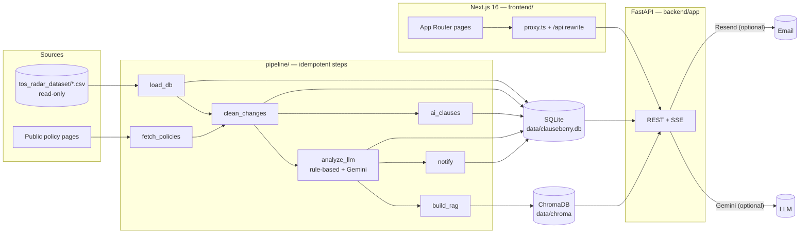

# Architecture



The browser only talks to the Next.js origin. `next.config.ts` rewrites `/api/*` to FastAPI, so the session
cookie is first-party and HTTP-only, and CORS is not needed for normal use.

## Data model

| Layer | Tables | Notes |
|---|---|---|
| Source | `apps`, `documents`, `policy_versions`, `source_changes` | Versions keep `source` (`dataset`/`fetched`), `source_ref` (CSV row or URL), `retrieved_at`, `quality_flag`. `source_changes` is the dataset's own diff file, kept verbatim. |
| Derived | `policy_changes`, `ai_clauses` | Recomputed from versions with `detector_version` provenance. |
| Generated | `change_analysis` | One row per (change, analyzer, input hash); `is_current` marks the one shown. Stores model, prompt version and timestamp. |
| Human | `evaluation_labels` | Written only by the evaluation scripts. |
| Users | `users`, `sessions`, `email_tokens`, `follows`, `alerts`, `notification_preferences`, `chat_sessions`, `chat_messages`, `email_outbox`, `upgrade_interest` | All cascade-delete with the user. |
| Ops | `pipeline_runs`, `fetch_log`, `monitoring_runs`, `pipeline_state`, `schema_migrations` | |

Migrations live in `database/migrations/*.sql` and are applied in order by `pipeline.common.migrate`
(both the API and every pipeline step call it on start-up).

## Local policy monitoring

The FastAPI lifespan starts a single in-process scheduler when `POLICY_MONITORING_ENABLED=true` (default).
It runs an initial scan when no scheduled run is recorded, then schedules checks at
`POLICY_CHECK_INTERVAL_HOURS` (default 24; supported range 1–720). The computer and backend must remain
running for scheduled checks. Set `POLICY_MONITORING_ENABLED=false` to disable the scheduler while keeping
authenticated manual checks available.

Sign in and open **Monitoring** to review per-app fetch health, recent runs, and the next scheduled scan.
**Check all now** starts a full scan; **Check now** on an app's detail page scans its configured policy pages.
These controls use only policy URLs already configured for tracked apps. A manual scan is limited to once per
target per hour; overlapping scans are rejected. Scan runs reuse the existing fetch → normalized diff →
rule-based analysis → AI-clause detection → RAG indexing → follower notification pipeline. No Gemini calls are
made by monitoring runs. Email notifications are sent only when the existing email provider is configured.
Policy fetches accept only HTTP(S) URLs resolving to public IP addresses, validate every redirect, and fail closed
when `robots.txt` cannot be fetched; a missing robots file (HTTP 404/410) is allowed.

Start the services from the project root and frontend directory:

```powershell
# Project root; use the existing virtual environment
.\.venv\Scripts\Activate.ps1
uvicorn backend.app.main:app --reload --port 8000

# Separate terminal
cd frontend
npm run dev
```

The authenticated API also exposes `GET /api/monitoring`, `GET /api/monitoring/runs/{id}`,
`POST /api/monitoring/check`, and `POST /api/monitoring/apps/{slug}/check` through the Next.js `/api` proxy.
The POST routes require a valid session and CSRF token. Monitoring uses the existing SQLite database and
Chroma index; the original CSV dataset remains read-only.

## Change detection (`pipeline/clean_changes.py`)

Consecutive *clean* versions of each document are diffed after normalisation (links, images, HTML tags,
Markdown emphasis, table pipes and whitespace removed). Each pair is stored with a verdict:

| Verdict | Meaning |
|---|---|
| meaningful | ≥ 8 words changed and none of the below |
| `formatting_only` | normalised texts identical |
| `reverted_or_variant` | new text equals an earlier version (A/B or regional variants) |
| `date_only` | only “last updated” / effective-date lines changed |
| `trivial_edit` | < 8 words changed |
| `probable_partial_capture` | ≥ 500 words removed with ≤ 5 % added |
| `restored_after_partial_capture` | the text lost in a partial capture comes back |
| `source_format_boundary` | first fetched version after archived ones (converter differences) |

Versions are flagged `suspected_capture_error` (error pages, < 150 words, or short-lived length anomalies
vs. the rolling median) and skipped. A missing version is never treated as evidence that a clause is new.

## Risk rubric (1–5)

Scores judge the potential privacy impact of the **change**, not the presence of legal vocabulary, and are
not legal judgements or trust ratings.

| Score | Level | Definition |
|---|---|---|
| 1 | Minimal | Editorial: formatting, dates, contact details or wording with no change to what data is handled or how. |
| 2 | Low | Clarifies or reorganises existing practices; no new data, recipients or purposes. |
| 3 | Medium | Changes collection, sharing, retention or user rights in a limited way, or substantial changes with unclear effect. |
| 4 | High | Expands collection, sharing, advertising/tracking or automated/AI processing, or narrows user rights/remedies (e.g. arbitration). |
| 5 | Critical | Newly permits training AI models on user content/data, selling or broadly sharing sensitive data, or removes key rights. |

The **rule-based analyzer** (`pipeline/taxonomy.py`, model `rules-v1`) applies this rubric with keyword
lexicons, direction detection and sensitive-data patterns; it reports no confidence. The **LLM analyzer**
(`pipeline/analyze_llm.py`, Gemini, prompt `llm-v1`) receives the rubric, returns JSON validated by Pydantic,
and its AI-training evidence is discarded unless it appears verbatim in the added text. Results are cached
by `sha256(prompt_version, model, added, removed)`.

## AI-clause detection

Every sentence of every clean version is classified (most specific wins):

1. `explicit_training` — training/develop/improve language **and** an AI/model term in the same sentence
   (staff-training sentences excluded).
2. `ai_provider_sharing` — sharing/processing with third-party AI providers.
3. `general_ai` — AI features, assistants, generative AI mentions.
4. `automated_processing` — profiling, automated decisions, algorithms, machine learning.

“First observed” is the earliest archived version containing explicit training language; when that is the
first archived version, the UI says the practice may predate coverage.

## KPI definitions

| KPI | Definition |
|---|---|
| Applications tracked | rows in `apps` |
| Policy versions | rows in `policy_versions` (all sources, including flagged captures); date filter on `version_date` |
| Raw changes | rows in `policy_changes` (consecutive clean-version pairs) |
| Meaningful changes | `policy_changes.is_meaningful = 1`, filtered on `change_date` |
| High-risk changes | meaningful changes whose current analysis has `risk_score >= 4` |
| Average risk score | mean current `risk_score` over meaningful analysed changes |

Analytics views (`database/migrations/002_views.sql`, `004_*.sql`) state their grain in comments
(`v_changes` is one row per change; joins to analysis use `is_current = 1`, so no double counting).

## RAG

* **Index** (`pipeline/build_rag.py`): latest clean version of each of the 52 documents, split by Markdown
  headings into ~220-word chunks with 40-word overlap, plus each meaningful change (summary + added/removed
  lines). Embeddings: `sentence-transformers/all-MiniLM-L6-v2` (local, CPU). Stable chunk ids and a per-source
  fingerprint mean only changed sources are re-embedded.
* **Query** (`backend/app/services/rag.py`): parse app names/aliases, document type and years from the
  question → filtered dense retrieval from Chroma (changes first for “what changed” questions) → lexical
  re-rank → max three chunks per source → distance threshold for “insufficient evidence”.
* **Answer**: with `GEMINI_API_KEY`, Gemini streams an answer constrained to numbered sources; citation
  markers that don't match a returned source are removed. Without a key, an **extractive** answer quotes
  the most relevant sentences with citations, and the UI labels the mode.
* Retrieved text is wrapped as untrusted data in the prompt; instructions inside documents are ignored.

## Security

* Argon2id password hashing; equal-time handling for unknown accounts; strength policy server-side.
* Server-side sessions (random token in an HttpOnly, SameSite=Lax cookie; only its SHA-256 stored;
  `Secure` in production). Remember-me = 30 days, otherwise 24 h browser-session cookie.
* CSRF: per-session token, double-submitted via `X-CSRF-Token` and compared with the server-side value on
  every POST/PUT/PATCH/DELETE.
* Authorization in every route; per-user rows are always filtered by `user_id` (tests cover isolation).
* Rate limits: auth endpoints per IP, sign-in also per account (20 / 15 min), Ask per user (in-memory; use
  Redis for multiple instances). The client IP is the socket peer; `X-Forwarded-For` is used only with
  `TRUSTED_PROXY_HOPS=N`, reading the N-th entry from the right so client-supplied entries are ignored.
* Emails: only `sent` when the provider returns a message id; bodies (which can contain reset tokens) are
  logged only in development.
* Errors are JSON with a request id; stack traces are logged, never returned.
* CSV exports neutralise spreadsheet formulas. Rendered policy Markdown drops images and opens links with
  `rel="noopener noreferrer nofollow"`.
